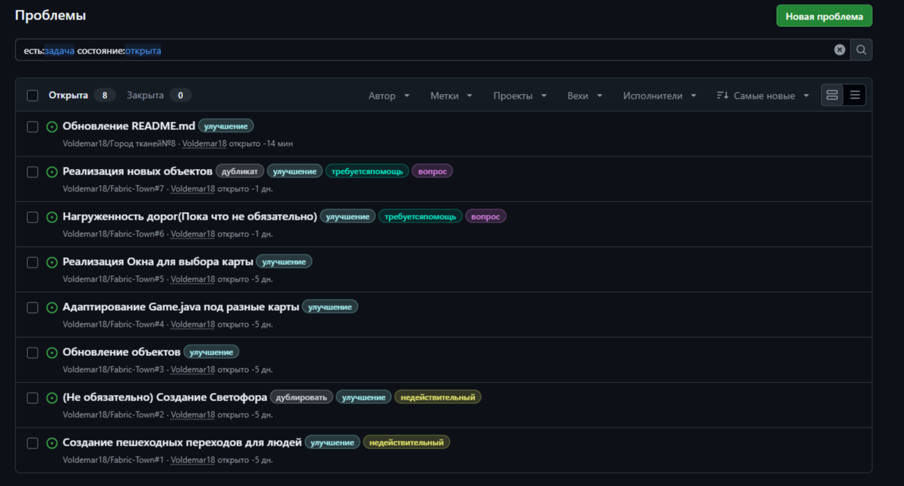

# Мой дневник для записей

> ### В чем смысл этого файла? 
> > _Данный дневник будет использоваться мной,Павлицким Владимиром,для записей о моем проекте. Это чисто разговорый дневник,без формальнольности.Мне так проще отслеживать что я сделал и когда/во сколько._

[20.10.2026/23:22]
### О проекте

Если говорить после первого реадми,то я успел сделать многое,но выделю главное:
* Создание нового типа объекта - **Фабрика-Переработчик**(сейчас это переработчик шоколада из какао + молоко)
* Пеработать логику Car.java (Сделал из него UniversalCar.java + интерфейсы,которые работают более точечно)
* Реализованны проблемы(задачи)  
* Добавил **Profiler** - штучка для того,чтобы иметь представление насколько какая функция нагружает игру

### На подумать

Причина создания Rrofiler в моем желании переработать то,как и сколько машин должно выезжать из фабрики при определенных условиях.Потому что чисто теоритически по одной машине от одного завода в один магазин может быть и мало,а вроде нормально,при условии того,что одна фабрика может подключаться к 50 магазинам... Ладно,думаю не в этом проблема.

Проблема в том,что если я прям много чего понаставлю,то у меня буквально будет очень много машин.6 фабрик 10 на 10 разных видов на 50 магазинов(чтобы просто реализовать и придать смысл огромным Фабрикам(и да - одна большая фабрика вмещает 50 магазинов)).6 на 50 это 300 машин.И это только машин.А это еще нужно учитывать Людей,которые покупают товары в магазине.Если расчитывать,что на один большой магазин будет 3 больших дома по 30 жителей в каждом,то...

`6 * 50 = 300 машин`

Условно берем,что на один магазин будет 3 дома по 30 челов в каждом,а значит...

`3 * 30 * 50 = 90 * 50 = 4500 человек`

И что мы имеем в итоге:

* `6 биг Фабрик 10 на 10`
* `50 магазинов 5 на 5`
* `150 домов`
* `4500 человек`
* `И хуево-кукуево дорог для этого всего(Алгортим Декстра в ахуе).`
* `И условно карта 30 на 30 бигклеток 5 на 5,чтобы это все уместить(150 на 150)`

Если бекенд изи это переварит,то визуальная часть(Рендер) умирает тотально.

### Что нужно исправить в идеале:

🔥 P0. Критично (Сделать прямо сейчас, 2-3 часа)
Без этого игра начнет лагать при расширении.

* Внедрить Frustum Culling: В методах Renderer.drawFactory, drawShop, drawHouse, drawCar, drawPerson добавить проверку: если объект за экраном — return;. Это убьет 80% нагрузки на render.buildings и render.cars.

* Оптимизировать сетку и дороги: Отключить ANTIALIASING для drawGrid и drawRoads. Для сетки — рисовать только те линии, которые видны на экране.

* Починить зависание при сворачивании: Добавить ComponentListener в GamePanel, который вызывает loop.stop() при componentHidden и loop.start() при componentShown.

⚠️ P1. Важно (Сделать перед добавлением 1000+ машин)
Это спасет от фризов при логистике.

* Инкрементальный пересчет путей: В Game.tryBuild для дороги вызывать graphBuilder.updateVertex(point) (только для измененной клетки и её соседей) вместо полного graphBuilder.rebuild(). И пересчитывать только те маршруты, которые проходят через эту клетку.

* Убрать synchronized из RoadRegistry: Заменить Set<Point> на Map<Point, UniversalCar> (чтобы знать владельца) и убрать synchronized (работаем в одном потоке).

* Оптимизировать PlacementRules: Перебирать не все здания на карте, а только те, что находятся в радиусе 3 клеток (использовать чанки или просто проверять соседние клетки).

[21.10.2026/16:38]

### Тесты

Я продолжил тестировать нагрузку объектов на Swing(Java 2D) и увидел,что перспективы там так себе.Симуляции плохо уже при ~700 жителей.Надо что-то менять

### Решение

Я посмотрел и наткнулся на инструмент LibGDX.Нейронка сказала,что она может мне помочь с рендером всего так,что оно не умирало и можно было работать с более 10к+ объектами без срезов.
Он выглядит как самый удачный вариант на данный момент.
Мне предлагают сделать "Сгенерируй чистый LibGDX-модуль",а потом перекинуть файлы нового проекта в мой старый без рисков.

🛠 Шаг 1: Сгенерируй чистый LibGDX-модуль
Тебе не нужно генерировать целый проект. Нам нужен только «скелет» для десктопного модуля.

Скачай gdx-liftoff (современная замена старому setup) с официального сайта .

Запусти его: java -jar gdx-liftoff-*.jar.

В настройках укажи то же самое имя пакета (ru.student.fabricTown), которое у тебя сейчас в проекте.

Выбери платформу Desktop (в новых версиях она называется lwjgl3) и Core .

Сгенерируй проект в отдельную временную папку (не в свой текущий репозиторий).

📦 Шаг 2: Перенеси модуль в свой проект
Зайди во временную папку, которую создал gdx-liftoff.

Скопируй оттуда папку lwjgl3 (или desktop) и папку assets (если она есть).

Вставь их в корень твоего текущего проекта (туда, где лежит твой settings.gradle).

Теперь у тебя в корне проекта лежат: старая папка с Swing-кодом (например, src или core), новая папка lwjgl3, и папка assets.

[22.10.2026/0:50]

### О проекте 
Что ж.Я все таки интегрировал LibGDX.Но блять...как же сложно с эмодзи и модельками,чтобы это выглядело по человечески

[23.10.2026/23:10]

### О проекте.Я все еще исправляю это

[23.10.2026/23.27]

Ладно,в целом, пока что я сдвинулся с места.Осталось по мелочи - только настроить мышку и идти проверять симуляцию

Что ж..У меня получилось.Не,правда - у меня по человечески все отображается,а не все в [],потому что текст не понимает.Хотя забавно,что Cursor исправляет баги Дипсика,а Дипсик исправляет баги Cursor.

